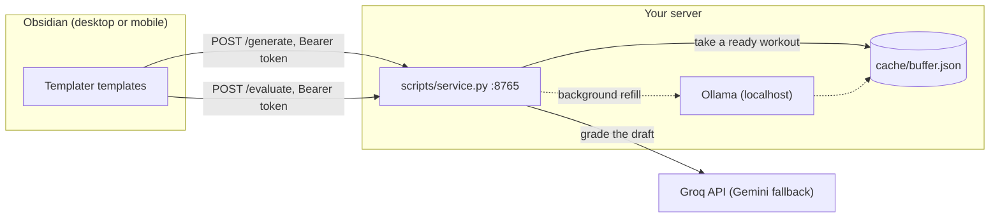

# doc-gym

[](https://github.com/iiimonfiiire/doc-gym/actions/workflows/test.yml)

A technical-writing practice loop inside Obsidian. A small self-hosted service generates writing workouts with a local Ollama model and grades drafts with Groq. Obsidian templates call it over HTTP, so it works on desktop and mobile.

A workout gives you raw inputs (commit messages, engineer notes, support tickets) and asks for a finished doc: release notes, an API reference, a troubleshooting guide, or a help-center article. You write the draft in the note. One hotkey grades it on technical clarity, tone, and scannability, with quoted rewrite suggestions.

The in-vault user guide is `vault-scaffold/README.md`.

## Architecture



- The service never touches the vault. Obsidian sends note text and writes the result back.
- The model returns JSON only. Python validates it, retries thin answers, and renders the note, so the format never drifts.
- Generation takes minutes on a small CPU server. The service keeps **one pre-generated workout per focus** in `cache/buffer.json`. A request takes one, applies the chosen intensity, a random tone, and today's date, and returns at once. A background thread refills it.
- If a focus isn't ready, `/generate` answers `503` at once with the list of ready focuses, and refills that focus next. Mobile apps drop requests that take minutes, so failing fast beats waiting. Pass `"wait": true` to generate live instead.
- Bump `PROMPT_VERSION` in `generate_prompt.py` whenever the prompt changes, so stale buffered workouts are discarded.

### API

| Method | Path | Body | Returns |
|---|---|---|---|
| GET | `/health` | | `{"ok", "buffer", "ready": [focus, ...]}` |
| POST | `/generate` | `{"intensity", "focus"[, "wait"]}` | `{"stem", "content", "buffered"}`, or `503` with `ready` |
| POST | `/evaluate` | `{"content"}` | `{"content", "grade", "score"}` |

POST needs `Authorization: Bearer $DOC_GYM_TOKEN`.

## Quickstart

Run the service locally against a local Ollama, no server needed:

```bash
cp .env.example .env               # set GROQ_API_KEY and DOC_GYM_TOKEN
ollama pull llama3.2:3b
python3 scripts/service.py         # listens on 127.0.0.1:8765
```

```bash
TOKEN=<your DOC_GYM_TOKEN>
curl -s localhost:8765/health
curl -s localhost:8765/generate -H "Authorization: Bearer $TOKEN" \
  -d '{"intensity": "Sprint", "focus": "API Specs", "wait": true}'
```

The CLIs work without the service:

```bash
python3 scripts/generate_prompt.py --intensity Sprint --focus "API Specs" --dry-run
python3 scripts/evaluate_draft.py "Doc Gym/Prompts/<note>.md" --dry-run
```

## Full setup (server + Obsidian)

Requirements:

- **Server:** Linux with systemd, Python 3.9+, [Ollama](https://ollama.com), and ufw. Tested on Ubuntu 24.04 with 4 GB RAM.
- **Desktop:** macOS or Linux with Obsidian and the Templater and Dataview plugins.
- **Accounts:** a Groq API key. Optionally a Gemini key as a fallback.
- **Mobile access away from home:** a VPN to the server, such as Tailscale.

Steps:

1. **Configure.** `cp .env.example .env` and fill in the required values. All deployment-specific settings live in `.env`, never in code.
2. **Ollama on the server** (one time): `sudo bash ops/server-ollama-setup.sh`, then `ollama pull llama3.2:3b`. With no arguments, Ollama listens on localhost only, which is all the service needs.
3. **Service on the server** (one time, root): `sudo bash ops/server-service-setup.sh <cidr> [...]`. List only the networks that should reach port 8765, e.g. your VPN range.
4. **Desktop** (Obsidian closed): `./install.sh`. It creates the vault folders, the service token, and `Doc Gym/.doc-gym.json`, and registers the Templater hotkey targets.
5. **Deploy:** `./ops/deploy-server.sh`. It copies the code and `.env` to the server and starts the systemd user service. Rerun it after code changes. No sudo needed.

## Configuration

All settings come from `.env` (see `.env.example`). Real environment variables win over `.env`.

| Variable | Required | Default | What |
|---|---|---|---|
| `GROQ_API_KEY` | yes | | Grades drafts |
| `DOC_GYM_TOKEN` | yes | | Shared secret for POST requests. `install.sh` generates it |
| `DOC_GYM_VAULT` | desktop | | Absolute path to the Obsidian vault |
| `DOC_GYM_SERVICE_URLS` | desktop | | Service addresses for the templates, comma-separated, tried in order |
| `DEPLOY_HOST` | deploy | | `user@host` for `ops/deploy-server.sh` |
| `DEPLOY_DIR` | | `doc-gym` | Install directory on the server, under the user's home |
| `DOC_GYM_BIND` | | `127.0.0.1:8765` | Listen address. The systemd unit sets `0.0.0.0:8765` |
| `DOC_GYM_BUFFER` | | `1` | `0` turns off pre-generated workouts |
| `DOC_GYM_CACHE_DIR` | | `cache/` | Where `buffer.json` lives |
| `DOC_GYM_ENV` | | `.env` | Path to an alternative env file |
| `OLLAMA_URL` | | `http://127.0.0.1:11434` | Ollama endpoint |
| `OLLAMA_MODEL` | | `llama3.2:3b` | Workout model |
| `OLLAMA_NUM_THREAD` | | Ollama's default | Thread cap for hosts that run hot |
| `OLLAMA_NUM_CTX` | | `2048` | Context window |
| `OLLAMA_NUM_PREDICT` | | `700` | Max tokens per workout |
| `OLLAMA_TIMEOUT` | | `300` | Seconds per generation |
| `GROQ_MODEL` | | `openai/gpt-oss-120b` | Grading model |
| `GEMINI_API_KEY` | | | Enables the Gemini fallback |
| `GEMINI_MODEL` | | `gemini-2.5-flash` | Fallback grading model |
| `OBSIDIAN_REST_TOKEN` | | | Desktop CLIs write through Obsidian's Local REST API when set |
| `OBSIDIAN_REST_URL` | | `https://127.0.0.1:27124` | Local REST API address |

## Tests

```bash
python3 -m venv .venv && .venv/bin/pip install -r requirements-dev.txt
.venv/bin/pytest
.venv/bin/ruff check .
```

The suite runs offline. Every model call is mocked, outbound HTTP is blocked, and no `.env` is read. It covers workout rendering, validation and retry of thin or malformed model output, the buffer and its refill loop, grading and score parsing, config loading, and the HTTP service itself (auth, fail-fast 503, body limits, error handling) on an ephemeral localhost port. Shell scripts get `bash -n`, plus `shellcheck` when it's installed. CI runs all of it on every push and pull request.

## Layout

| Path | What |
|---|---|
| `scripts/service.py` | HTTP service (stdlib only) |
| `scripts/generate_prompt.py`, `evaluate_draft.py` | Core logic, also usable as CLIs against the vault |
| `scripts/common.py` | Env loading, HTTP, frontmatter, note I/O |
| `scripts/configure_templater.py`, `write_client_config.py` | Used by `install.sh` |
| `vault-scaffold/` | Templates, Dashboard, and guide copied into `<vault>/Doc Gym/` |
| `ops/` | Server setup, systemd user unit, deploy script, firewall helper, NVIDIA driver cleanup |
| `tests/` | pytest suite |

After changing `vault-scaffold/`, run `./install.sh --force`. That overwrites the vault copies.

## Security

See [SECURITY.md](SECURITY.md) for the threat model and how to report a problem. In short:

- The service binds to localhost by default. On the server, ufw limits port 8765 to the networks you list. Reach it over a VPN; it speaks plain HTTP.
- The Groq key lives only in `.env` (`chmod 600`, gitignored). The vault holds only the service token.
- To change who can reach a port later: `sudo bash ops/server-firewall.sh <port> [<cidr> ...]`. It replaces every ufw rule for that port, and with no networks the port is closed.

## Known issue: Ollama installer and old NVIDIA GPUs

Ollama's `install.sh` installs the NVIDIA CUDA driver whenever it sees an NVIDIA GPU. On GPUs too old for that driver, udev retries loading it endlessly, and the CPU overheats and throttles. `ops/server-remove-nvidia.sh` removes the driver and pins it out. Later Ollama upgrades through `install.sh` then error at the CUDA step, which is harmless.

## License

[MIT](LICENSE)
