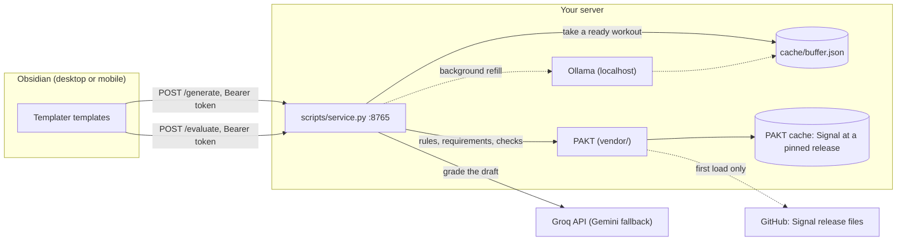

# doc-gym

[](https://github.com/iiimonfiiire/doc-gym/actions/workflows/test.yml)

Doc Gym is a technical-writing practice loop inside Obsidian. A small self-hosted service generates writing workouts with a local Ollama model. It grades each draft against the [Signal style guide](https://github.com/iiimonfiiire/signal-style-guide), with deterministic checks from [PAKT](https://github.com/iiimonfiiire/pakt) and a review from Groq. Obsidian templates call the service over HTTP, so it works on desktop and mobile.

A workout gives you raw inputs, such as commit messages, engineer notes, or support tickets. It asks for one finished document of a Signal content type, and it lists that type's Signal requirements. You write the draft in the note. One hotkey grades it on technical clarity, voice, scannability, and Signal compliance. The evaluation lists every rule violation with a quote and a fix, and then suggests rewrites.

The in-vault user guide is `vault-scaffold/README.md`.

## Architecture



- **No vault access** – The service never touches the vault. Obsidian sends the note text and writes the result back.
- **Fixed note format** – The workout model returns JSON only. Python validates it, retries thin answers, and renders the note.
- **Signal through PAKT** – Doc Gym holds no copy of Signal. PAKT resolves the pinned Signal release, caches it, and loads its rules pack. For each content type, Doc Gym renders the rules and requirements into the workout, with every per-type override applied.
- **Grading** – PAKT runs Signal's deterministic checks on the draft. The grader model receives the rules, the requirements, and those findings, and scores four criteria out of 40. Python renders the findings, so the model cannot invent them.
- **Workout buffer** – Generation takes minutes on a small CPU server. The service keeps one pre-generated workout per focus in `cache/buffer.json`. A request takes one, applies the chosen intensity, the Signal requirements, and today's date, and returns at once. A background thread refills the buffer, requested focuses first.
- **Fail fast** – If a focus is not ready, `/generate` answers `503` at once with the list of ready focuses. The service refills that focus next. Mobile apps drop requests that take minutes. Pass `"wait": true` to generate live instead.
- **Prompt changes** – Bump `PROMPT_VERSION` in `generate_prompt.py` whenever the prompt changes. The service then discards stale buffered workouts.

### Focuses

| Focus | PAKT content type |
|---|---|
| SaaS Docs | `kb_task` |
| API Specs | `api_doc` |
| Troubleshooting | `kb_troubleshooting` |
| Release Notes | `release_note` |
| UX Microcopy | `ui_microcopy` |
| GTM Brief | `gtm_brief` |
| Product Walkthrough | `walkthrough` |
| Tutorial | `tutorial`, or `quickstart` on Sprint |

`FOCUS_TYPE` in `scripts/generate_prompt.py` holds this mapping. The rules pack decides the voice: instructional types use `you` and imperatives, and release notes and GTM briefs allow `we`.

### API

| Method | Path | Body | Returns |
|---|---|---|---|
| GET | `/health` | | `{"ok", "buffer", "ready": [focus, ...]}` |
| POST | `/generate` | `{"intensity", "focus"[, "wait"]}` | `{"stem", "content", "buffered"}`, or `503` with `ready` |
| POST | `/evaluate` | `{"content"}` | `{"content", "grade", "score"}`, with `score` out of 40 |

POST needs `Authorization: Bearer $DOC_GYM_TOKEN`.

## PAKT and Signal versions

Doc Gym pins two versions:

- **PAKT** – `pakt.lock` pins a full PAKT commit in `PAKT_REF`. Switch it to a release tag once PAKT publishes one.
- **Signal** – The pinned PAKT commit pins a Signal release. To grade against another release, set `DOC_GYM_GUIDE` to any PAKT guide source, such as `github:iiimonfiiire/signal-style-guide@<tag>`.

To take a Signal update, bump `PAKT_REF` or `DOC_GYM_GUIDE`, and then run `./ops/deploy-server.sh`.

`ops/vendor-pakt.sh` fetches PAKT at `PAKT_REF` with your local git credentials, so it works while the PAKT repo is private. It copies the `pakt` package and `content-types.toml` into `vendor/`. The scripts add `vendor/` to `sys.path`, so the server needs no virtual environment and no extra packages. Doc Gym imports only PAKT's stdlib-only modules, never its model-review path.

PAKT downloads the Signal rules pack and prose once, and caches them under `~/.cache/pakt`. Because Doc Gym pins the guide, later loads need no network.

## Quickstart

Run the service on your desktop against a local Ollama, with no server.

1. Vendor PAKT, and create your config.

   ```bash
   ./ops/vendor-pakt.sh
   cp .env.example .env               # set GROQ_API_KEY and DOC_GYM_TOKEN
   ```

2. Pull the model, and start the service. It listens on `127.0.0.1:8765`.

   ```bash
   ollama pull llama3.2:3b
   python3 scripts/service.py
   ```

3. Check the service, and generate a workout.

   ```bash
   TOKEN=<your DOC_GYM_TOKEN>
   curl -s localhost:8765/health
   curl -s localhost:8765/generate -H "Authorization: Bearer $TOKEN" \
     -d '{"intensity": "Sprint", "focus": "API Specs", "wait": true}'
   ```

The CLIs also work without the service:

```bash
python3 scripts/signal_guide.py --type release_note   # fetch and cache Signal, then print the rules
python3 scripts/generate_prompt.py --intensity Sprint --focus "UX Microcopy" --dry-run
python3 scripts/evaluate_draft.py "Doc Gym/Prompts/<note>.md" --dry-run
```

## Full setup

Requirements:

- **Server** – Linux with systemd, Python 3.11+, [Ollama](https://ollama.com), and ufw. Tested on Ubuntu 24.04 with 4 GB of RAM.
- **Desktop** – macOS or Linux. Obsidian with its Templater and Dataview plugins. Git access to the PAKT repo.
- **Accounts** – A Groq API key. A Gemini key is optional, as a fallback.
- **Mobile access away from home** – A VPN to the server, such as Tailscale.

Steps:

1. Run `cp .env.example .env`, and fill in the required values. All deployment-specific settings live in `.env`, never in code.
2. On the server, run `sudo bash ops/server-ollama-setup.sh` once, and then run `ollama pull llama3.2:3b`. With no arguments, Ollama listens on localhost only, which is all the service needs.
3. On the server, run `sudo bash ops/server-service-setup.sh <cidr> [...]` once. List only the networks that can reach port 8765, such as your VPN range.
4. On the desktop, quit Obsidian, and run `./install.sh`. It creates the vault folders, the service token, and `Doc Gym/.doc-gym.json`. It also registers the Templater hotkey targets.
5. Run `./ops/deploy-server.sh`. It first vendors PAKT. It then copies the code and `.env` to the server, caches Signal there, and starts the systemd user service. Run it again after code changes. It needs no sudo.

## Configuration

All settings come from `.env`, as listed in `.env.example`. Real environment variables take precedence over `.env`.

| Variable | Required | Default | What |
|---|---|---|---|
| `GROQ_API_KEY` | yes | | Grades drafts |
| `DOC_GYM_TOKEN` | yes | | Shared secret for POST requests. `install.sh` generates it |
| `DOC_GYM_VAULT` | desktop | | Absolute path to the Obsidian vault |
| `DOC_GYM_SERVICE_URLS` | desktop | | Service addresses for the templates, comma-separated, tried in order |
| `DEPLOY_HOST` | deploy | | `user@host` for `ops/deploy-server.sh` |
| `DEPLOY_DIR` | | `doc-gym` | Install directory on the server, under the user's home |
| `DOC_GYM_BIND` | | `127.0.0.1:8765` | Listen address. The systemd unit sets `0.0.0.0:8765` |
| `DOC_GYM_BUFFER` | | `1` | `0` turns off pre-generated workouts |
| `DOC_GYM_CACHE_DIR` | | `cache/` | Where `buffer.json` lives |
| `DOC_GYM_ENV` | | `.env` | Path to an alternative env file |
| `DOC_GYM_GUIDE` | | `signal` | PAKT guide source. `signal` is the release that the pinned PAKT commit pins |
| `DOC_GYM_VENDOR` | | `vendor/` | Folder that holds the vendored `pakt` package |
| `PAKT_CACHE_DIR` | | `~/.cache/pakt` | Where PAKT caches the guide |
| `PAKT_OFFLINE` | | | `1` stops PAKT from downloading. An uncached guide then fails to load |
| `OLLAMA_URL` | | `http://127.0.0.1:11434` | Ollama endpoint |
| `OLLAMA_MODEL` | | `llama3.2:3b` | Workout model |
| `OLLAMA_NUM_THREAD` | | Ollama's default | Thread cap for hosts that run hot |
| `OLLAMA_NUM_CTX` | | `2048` | Context window |
| `OLLAMA_NUM_PREDICT` | | `700` | Max tokens per workout |
| `OLLAMA_TIMEOUT` | | `300` | Seconds per generation |
| `GROQ_MODEL` | | `openai/gpt-oss-120b` | Grading model |
| `GEMINI_API_KEY` | | | Turns on the Gemini fallback |
| `GEMINI_MODEL` | | `gemini-2.5-flash` | Fallback grading model |
| `OBSIDIAN_REST_TOKEN` | | | Desktop CLIs write through Obsidian's Local REST API when set |
| `OBSIDIAN_REST_URL` | | `https://127.0.0.1:27124` | Local REST API address |

## Tests

```bash
./ops/vendor-pakt.sh
python3 -m venv .venv && .venv/bin/pip install -r requirements-dev.txt
.venv/bin/pytest
.venv/bin/ruff check .
```

The suite runs offline. It mocks every model call, blocks outbound HTTP, and reads no `.env`. PAKT serves Signal from a fixture copy of the rules pack in `tests/fixtures/signal/`, through a private cache.

The suite covers the following:

- Workout rendering, with the Signal requirements for every focus
- Validation and retry of thin or malformed model output
- The buffer and its refill loop
- Grading: four criteria, score clamping, letter grades, deterministic findings, and older workouts
- Config loading, and PAKT loading from `vendor/`
- The HTTP service on an ephemeral localhost port: auth, the fail-fast `503`, body limits, and error handling

Shell scripts get `bash -n`, plus `shellcheck` when the machine has it. Without PAKT, the tests that need it skip with a message. Set `DOC_GYM_REQUIRE_PAKT=1` to make a missing PAKT fail the run instead.

CI runs the suite on every push and pull request. It checks out PAKT at `PAKT_REF` with the `PAKT_READ_TOKEN` secret. Without that secret, and while PAKT is private, the PAKT tests skip in CI.

## Layout

| Path | What |
|---|---|
| `scripts/service.py` | HTTP service (stdlib only) |
| `scripts/generate_prompt.py`, `evaluate_draft.py` | Core logic, also usable as CLIs against the vault |
| `scripts/signal_guide.py` | The bridge to PAKT: guide loading, per-type rules, and deterministic checks |
| `scripts/common.py` | Env loading, HTTP, frontmatter, and note I/O |
| `scripts/configure_templater.py`, `write_client_config.py` | Used by `install.sh` |
| `pakt.lock` | The pinned PAKT commit |
| `vault-scaffold/` | Templates, Dashboard, and guide that `install.sh` copies into `<vault>/Doc Gym/` |
| `ops/` | Server setup, the systemd user unit, the deploy and vendor scripts, a firewall helper, and NVIDIA driver cleanup |
| `tests/` | pytest suite and the Signal fixture |

After you change `vault-scaffold/`, run `./install.sh --force`. It overwrites the vault copies.

## Security

[SECURITY.md](SECURITY.md) describes the threat model and how to report a problem. In short:

- The service binds to localhost by default. On the server, ufw limits port 8765 to the networks you list. Reach it over a VPN, because it speaks plain HTTP.
- The Groq key lives only in `.env`, which is `chmod 600` and gitignored. The vault holds only the service token.
- The server makes outbound HTTPS requests to GitHub for the Signal release files, once per pinned release.
- To change who can reach a port later, run `sudo bash ops/server-firewall.sh <port> [<cidr> ...]`. It replaces every ufw rule for that port. With no networks, it closes the port.

## Known issue: Ollama installer and old NVIDIA GPUs

Ollama's `install.sh` installs the NVIDIA CUDA driver whenever it detects an NVIDIA GPU. On GPUs too old for that driver, udev retries loading it endlessly, and the CPU overheats and throttles. `ops/server-remove-nvidia.sh` removes the driver and pins it out. Later Ollama upgrades through `install.sh` then fail at the CUDA step, which is harmless.

## License

[MIT](LICENSE)
